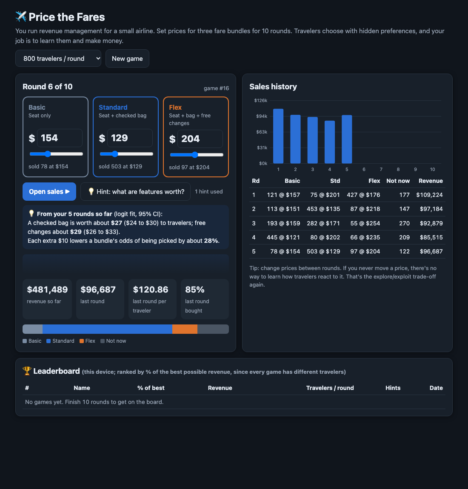
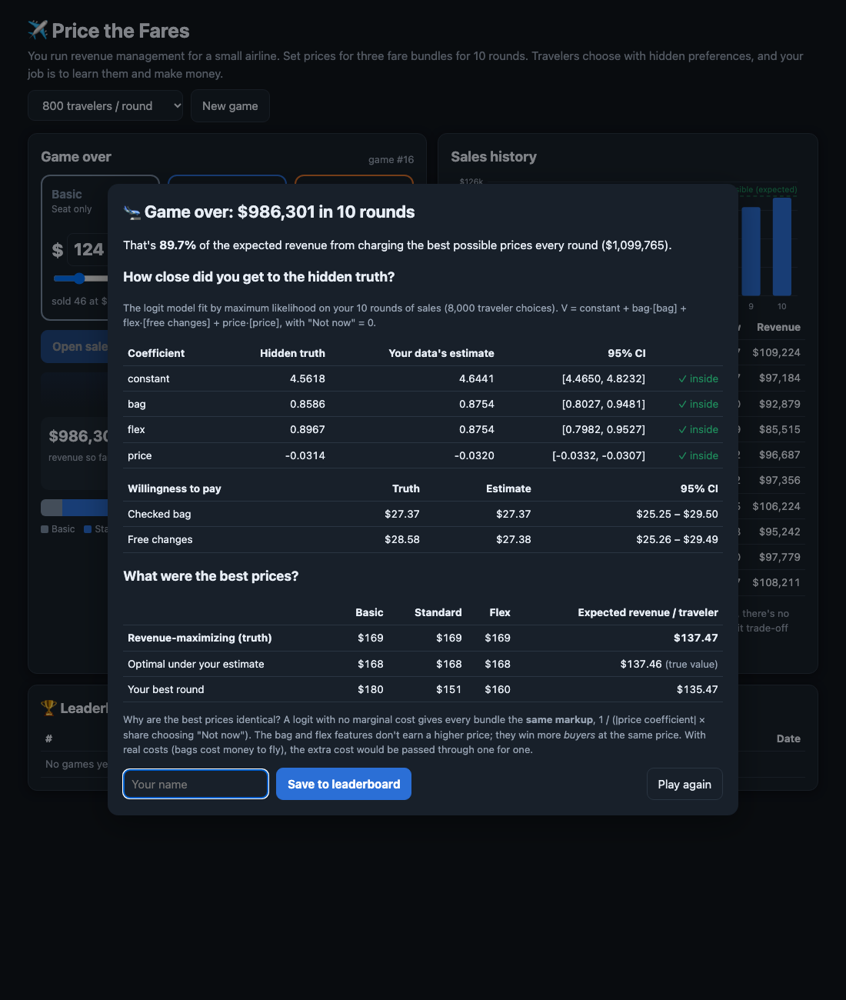

# Price the Fares ✈️

A single-file airline revenue game inspired by the Larkspur Air case in DSO 429 HW4 Part 2.

**How a game works:**
- **Your job:** you run pricing for three fare bundles: **Basic** (seat only), **Standard** (+ checked bag) and **Flex** (+ bag + free changes).
- **Each round:** you set three prices, and a few hundred simulated travelers choose a bundle or "Not now" using a **logit model with hidden coefficients**.
- **After 10 rounds:** the game fits a logit by maximum likelihood to *your* sales data and shows two things. First, how close the estimates got to the hidden truth. Second, what the revenue-maximizing prices actually were.

| Mid-game with a hint | End-of-game reveal |
|---|---|
|  |  |

## Play

Open `index.html`. Pick 300, 800 or 2,000 travelers per round: more travelers means less noise and easier learning.

- **Hidden truth:** new every game, drawn near the HW4 colleague's model (constant 3.6–5.2, bag 0.5–1.3, flex 0.3–1.0, price −0.022 to −0.036 per $).
- **💡 Hint button:** fits the logit to your rounds so far and shows the estimated **willingness to pay** for a bag and for free changes (with 95% CIs, delta method), plus how much each extra $10 cuts a bundle's odds. If your prices haven't varied enough to identify the effects, it says so.
- **End screen:**
  - estimates against the truth, with ✓ or ✗ for whether each 95% CI covers it
  - WTP truth against estimate
  - the revenue-maximizing prices under the truth, the optimal prices under *your* estimate (with their true value), and your best round
- **Leaderboard** (`localStorage`, top 10): ranked by **% of the best possible expected revenue**, which is fair across games with different hidden travelers. It also shows hints used.

URL options: `?seed=42` replays the same hidden travelers, and `?auto=5&hint=1` plays 5 rounds automatically for demos.

## The economics

- **Choice:** P(bundle j) = e<sup>V<sub>j</sub></sup> / (1 + Σ<sub>k</sub> e<sup>V<sub>k</sub></sup>), with V = constant + β<sub>bag</sub>·bag + β<sub>flex</sub>·flex + β<sub>price</sub>·price, and "Not now" at V = 0.
- **Estimation:** maximum likelihood on round-level counts, LL = Σ<sub>rounds</sub> Σ<sub>j</sub> count<sub>j</sub> · log P<sub>j</sub>, using Newton–Raphson with step-halving. SEs come from the inverse Hessian.
- **Optimal prices:** with zero marginal cost, a multinomial logit gives every bundle the **same markup**, m = 1 / (|β<sub>price</sub>| · s<sub>0</sub>), where s<sub>0</sub> is the "Not now" share at those prices. It's solved by bisection. Features don't earn a higher price; they win more buyers at the same price.
- **Learning requires exploring:** if you never move a price, the price effect isn't identified and the fit refuses. It's the same trade-off as the bandit problems in Part 3.

## Tests

```
node test.mjs
```

There are 16 checks. They load the `<script id="core">` block straight from `index.html`:

- **HW4 2A:** Basic $139 and Standard $159 give shares 0.326 / 0.440 / 0.234, with Flex priced out of the market.
- **WTP formula:** the colleague's model gives $30 for a bag and $20 for free changes.
- **Simulated travelers:** frequencies match the logit shares (400,000 draws).
- **Optimal prices:** for three coefficient sets the first-order condition holds, no nearby prices do better, and a 21³ brute-force grid agrees.
- **The MLE across 300 simulated games:** it converges every time, it's unbiased (mean z ≈ 0), and the 95% CIs cover the truth 94–95% of the time for all four coefficients.
- **At the fit:** the gradient is about 0, and constant prices are correctly refused as not identified.
